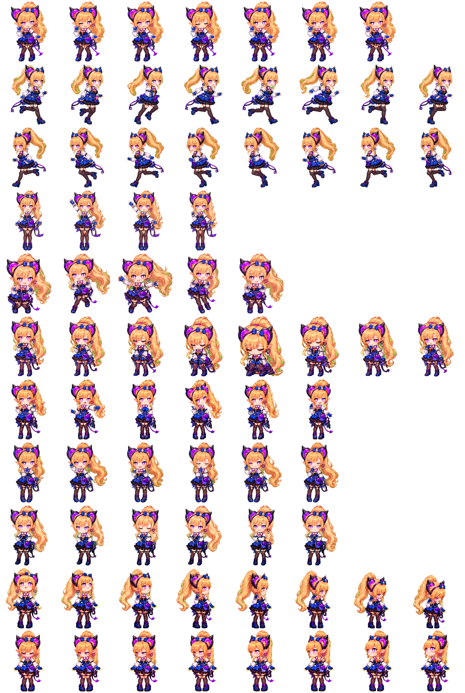

# Codex Pets: Liino

這裡提供一款以 Liino 為主題的 Codex 寵物：[Codex Pets](https://developers.openai.com/codex/app/settings#pets)。

安裝之後，你寫 Code 時就不再是孤軍奮戰。

每當你完成任務、或是遇到突發狀況時，Liino 就會在旁邊帶著俏皮的自信盯著你，像是在說：

「哎呀，這種程度的挑戰，怎麼可能難得倒我們呢？」



## 安裝

最簡單的安裝方式是在 Codex app 直接輸入以下提示詞：

```text
安裝 cdcd72/codex-pet-liino repo 的 Codex Pet 給我的 Codex app 使用
```

如果你想手動安裝，這個 repo 的 CI 會產出 GitHub Pages 套件：

```text
https://cdcd72.github.io/codex-pet-liino/liino.codex-pet.zip
```

macOS 或 Linux 可在終端機執行：

```sh
curl -sL "https://cdcd72.github.io/codex-pet-liino/liino.codex-pet.zip" -o "/tmp/liino.codex-pet.zip" && mkdir -p "$HOME/.codex/pets/liino" && unzip -o "/tmp/liino.codex-pet.zip" -d "$HOME/.codex/pets/liino"
```

Windows PowerShell 可執行：

```powershell
New-Item -ItemType Directory -Force "$HOME/.codex/pets/liino" | Out-Null
Invoke-WebRequest "https://cdcd72.github.io/codex-pet-liino/liino.codex-pet.zip" -OutFile "$env:TEMP/liino.codex-pet.zip"
Expand-Archive -Path "$env:TEMP/liino.codex-pet.zip" -DestinationPath "$HOME/.codex/pets/liino" -Force
```

執行後，Codex 會在 `~/.codex/pets/liino` 讀取這個寵物。

## 使用

1. 下載並解壓縮寵物檔案。
2. 確認 `~/.codex/pets/liino` 內有 `pet.json` 與 `spritesheet.webp`。
3. 重新啟動 Codex 並到設定中的寵物選單選取 `Liino`。
4. 到聊天視窗輸入 `/pet` 或從指令選單啟用寵物功能。
5. 啟用後，Liino 就會在介面中依狀態播放對應動畫。

## 檔案說明

- `pet.json`: 寵物的中繼資料。
- `spritesheet.webp`: 寵物的圖像素材。

## 授權說明

- 本專案為《明日方舟：終末地》（Arknights: Endfield）的非官方同人二次創作，由個人基於興趣與粉絲活動製作，免費提供，**不得用於商業營利**。
- 本專案屬於官方[《明日方舟：終末地》二創與發布相關活動指南](https://endfield.gryphline.com/zh-tw/news/4497)（2026/02/03 公告）所涵蓋的個人非營利二次創作範圍，並遵守其中的禁止事項：不冒充官方、不可能被誤認為官方商品或企劃、不含違法或損害角色形象的內容。
- 該指南可能不另行通知而變更，若與官方最新公告有出入，以官方公告為準。
- 角色「Liino」及其相關名稱、設定與原始美術素材，其著作權與商標權均歸原權利人（Gryph Frontier Pte. Ltd. 與其關係企業，品牌為 GRYPHLINE）所有。
- 本專案與上述公司沒有任何隸屬或合作關係；若權利人認為內容不妥，請聯繫作者，將立即處理。
